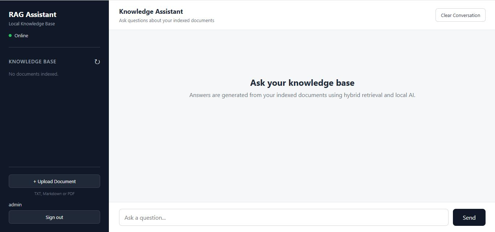

# Local Corrective RAG Assistant

A full-stack Retrieval-Augmented Generation (RAG) application for
question answering over a local document knowledge base.

The system combines **semantic vector search and BM25 keyword retrieval**,
uses **Reciprocal Rank Fusion and cross-encoder reranking**, and implements
a **corrective RAG workflow with LangGraph** to grade retrieved documents
and retry retrieval when necessary.

Generation runs locally using **Ollama**, while **FastAPI** exposes the
backend to a lightweight web interface.

### Screenshots

**Signed-in dashboard** with the per-user knowledge base and document upload:



## Highlights

- Hybrid Chroma + BM25 retrieval
- Reciprocal Rank Fusion (RRF)
- Cross-encoder reranking
- Corrective retrieval with LangGraph
- LLM-based document relevance grading
- Conversational query rewriting
- Structured citations with source excerpts
- Dynamic TXT, Markdown and PDF ingestion
- Local generation with Ollama
- FastAPI REST API
- Web-based chat and document management
- JWT authentication with token revocation and login rate limiting
- Per-user private knowledge bases and persistent chat history (MySQL)
- Reproducible retrieval benchmark (Hit@K, MRR, reranker-score threshold analysis)
- Prompt-injection defences and an offline test suite with CI

## Features

- Local RAG pipeline
- Conversational question answering
- Query rewriting for follow-up questions
- Semantic retrieval with Chroma
- Keyword retrieval with BM25
- Reciprocal Rank Fusion (RRF)
- Cross-encoder reranking
- LLM-based document relevance grading
- Corrective query rewriting and retrieval retry
- Structured source citations
- TXT, Markdown, and PDF ingestion
- Dynamic document upload and deletion
- FastAPI REST API
- LangGraph workflow orchestration
- Local LLM inference with Ollama
- Web-based chat interface
- Retrieval evaluation with Hit@K, MRR, and out-of-scope score analysis
- Prompt-injection hardening of all LLM prompts
- Admin-controlled multi-user accounts (PBKDF2 password hashing, JWT with `jti` revocation)
- Per-user document isolation in both the filesystem and the vector store
- Persistent conversation history in MySQL
- Document versioning with content-hash deduplication
- Liveness (`/health`) and readiness (`/health/ready`) endpoints

## Architecture

```text
                          User
                            │
                            ▼
                      Web Frontend
                            │
                            ▼
                         FastAPI
                            │
                            ▼
                       LangGraph
                            │
                    Query Rewriting
                            │
                            ▼
                 ┌─────────────────────┐
                 │  Hybrid Retrieval   │
                 │                     │
                 │ Chroma       BM25   │
                 └──────┬───────┬──────┘
                        │       │
                        └───┬───┘
                            ▼
                  Reciprocal Rank Fusion
                            │
                            ▼
                    Cross-Encoder Reranker
                            │
                            ▼
                     Document Grader
                            │
                   ┌────────┴────────┐
                   │                 │
               Relevant        Not Relevant
                   │                 │
                   │          Corrective Rewrite
                   │                 │
                   │          Retrieval Retry
                   │                 │
                   │          Still irrelevant?
                   │                 │
                   │              Fallback
                   ▼
                     Ollama LLM
                         │
                         ▼
               Answer + Citations
```

## RAG Pipeline

### 1. Document ingestion

TXT, Markdown, and PDF documents are loaded and split into overlapping chunks.

Each chunk receives metadata including:

- source
- filename
- file type
- page number where available
- stable chunk ID

### 2. Embeddings

Chunks are embedded using:

`sentence-transformers/all-MiniLM-L6-v2`

Embeddings are stored locally in Chroma.

### 3. Hybrid retrieval

Two retrieval strategies are combined:

**Semantic retrieval**

Chroma performs vector similarity search.

**Keyword retrieval**

BM25 provides lexical matching for exact terms and technical keywords.

### 4. Reciprocal Rank Fusion

Results from vector search and BM25 are combined using Reciprocal Rank Fusion (RRF).

This avoids directly combining incompatible vector-distance and BM25 score scales.

### 5. Cross-encoder reranking

The retrieved candidates are reranked using:

`cross-encoder/ms-marco-MiniLM-L-6-v2`

The cross-encoder jointly evaluates the query and candidate chunk to improve final ranking quality.

### 6. Document grading

An LLM relevance grader checks whether the final retrieved chunks contain information useful for answering the question.

If no relevant documents remain, the LangGraph workflow can perform a corrective query rewrite and retry retrieval.

### 7. Grounded generation

The final relevant context is passed to a local Ollama model.

The model is instructed to answer only from retrieved context and reference supporting chunks using source identifiers such as:

`[Source 1]`

### 8. Structured citations

The API returns citation metadata including:

- source
- filename
- file type
- page
- chunk ID
- reranker relevance score
- excerpt

## Tech Stack

### AI / RAG

- Python
- LangChain
- LangGraph
- SentenceTransformers
- Chroma
- BM25
- CrossEncoder
- Ollama

### Backend

- FastAPI
- Pydantic
- Uvicorn
- SQLAlchemy + PyMySQL (MySQL)
- PyJWT

### Frontend

- HTML
- CSS
- JavaScript

## Project Structure

```text
rag-learning/
├── frontend/            # Static HTML/CSS/JS chat UI
├── src/                 # FastAPI app, RAG pipeline, auth, models
├── data/users/<user>/   # Per-user uploaded documents (git-ignored)
├── vector_store/        # Local Chroma database (git-ignored)
├── eval/                # Benchmark corpus (16 docs) and labelled questions (50)
├── tests/               # Offline pytest suite (mocked LLM, SQLite)
├── .github/workflows/   # CI: runs the test suite
├── screenshots/
├── .env.example         # Configuration template
├── reset_admin_password.py  # Generates a bootstrap admin password hash
├── pytest.ini
├── requirements.txt
├── requirements-dev.txt # Test dependencies
├── .gitignore
└── README.md
```

Key backend modules:

| Module | Responsibility |
|---|---|
| `api.py` | FastAPI app, chat, document and session endpoints |
| `auth.py`, `auth_routes.py` | JWT creation/validation, login, user management, logout |
| `rag_graph.py` | LangGraph corrective RAG workflow |
| `hybrid_search.py`, `bm25_search.py`, `search.py` | Vector, BM25 and RRF retrieval |
| `reranker.py`, `document_grader.py` | Cross-encoder reranking and LLM relevance grading |
| `knowledge_base.py`, `vector_store.py` | Per-user indexing into Chroma |
| `database.py`, `*_models.py` | SQLAlchemy engine and MySQL tables |
| `prompt_safety.py` | Fencing and sanitising of untrusted text in prompts |
| `eval_env.py`, `compare_retrieval.py`, `evaluate_retrieval.py` | Isolated, reproducible retrieval benchmark |

## Prerequisites

Install:

- Python 3.10+
- MySQL 8+ (or MariaDB / XAMPP MySQL)
- Ollama
- Git

Pull the local model:

```bash
ollama pull llama3.2
```

## Installation

Clone the repository:

```bash
git clone https://github.com/soumen267/corrective-rag-assistant.git
cd rag-learning
```

Create a virtual environment:

### Windows

```powershell
python -m venv .venv
.venv\Scripts\Activate.ps1
```

### macOS / Linux

```bash
python3 -m venv .venv
source .venv/bin/activate
```

Install dependencies:

```bash
python -m pip install -r requirements.txt
```

## Configuration

Create the MySQL database (tables are created automatically on startup):

```sql
CREATE DATABASE rag_assistant CHARACTER SET utf8mb4 COLLATE utf8mb4_unicode_ci;
```

Copy the template and fill in the values:

```bash
cp .env.example .env        # Windows: copy .env.example .env
```

| Variable | Required | Purpose |
|---|---|---|
| `RAG_AUTH_SECRET` | yes | JWT signing secret, at least 32 bytes |
| `RAG_ADMIN_USERNAME` / `RAG_ADMIN_PASSWORD_HASH` | for first setup | Bootstrap admin login |
| `MYSQL_DATABASE`, `MYSQL_USER` | yes | MySQL connection |
| `MYSQL_HOST`, `MYSQL_PORT`, `MYSQL_PASSWORD` | no | Defaults: `127.0.0.1`, `3306`, empty |
| `OLLAMA_BASE_URL`, `OLLAMA_MODEL`, `OLLAMA_TIMEOUT_SECONDS` | no | Defaults: `http://127.0.0.1:11434`, `llama3.2`, `120` |
| `CORS_ALLOW_ORIGINS` | no | Comma-separated browser origins; default `http://127.0.0.1:5500,http://localhost:5500`. `*` is refused |
| `RAG_EVAL_OWNER_ID` | only for `src/test_graph.py` | User whose real knowledge base the manual graph script queries (the benchmark does not need it) |

Generate a secret:

```bash
python -c "import secrets; print(secrets.token_urlsafe(48))"
```

## Run the Backend

Make sure MySQL and Ollama are running, then:

```bash
python -m uvicorn api:app --app-dir src --reload
```

FastAPI:

```text
http://127.0.0.1:8000
```

Swagger documentation:

```text
http://127.0.0.1:8000/docs
```

## Run the Frontend

Open another terminal:

```bash
cd frontend
python -m http.server 5500
```

Open:

```text
http://127.0.0.1:5500
```

Sign in with an account created by an administrator (see
[Authentication](#authentication)). The page returns to the sign-in screen
automatically when the token expires or is revoked.

## Authentication

All endpoints except `/health`, `/health/ready` and `/auth/login` require
`Authorization: Bearer <token>`. Accounts are created by an administrator;
there is no public sign-up.

### Create the first admin

Generate a password hash for the bootstrap admin (run from the project root)
and put it in `.env` as `RAG_ADMIN_PASSWORD_HASH`:

```bash
python reset_admin_password.py
```

The script prompts for the password (minimum 12 characters), prints the hash
and does not modify `.env`.

Log in with that bootstrap admin, then create database users via
`POST /auth/users` (Swagger UI at `/docs` → *Authorize*).

### Example

```bash
# 1. Log in
curl -X POST http://127.0.0.1:8000/auth/login \
  -H "Content-Type: application/json" \
  -d '{"username": "admin", "password": "YOUR_PASSWORD"}'

# 2. Ask a question
curl -X POST http://127.0.0.1:8000/chat \
  -H "Authorization: Bearer TOKEN" \
  -H "Content-Type: application/json" \
  -d '{"question": "What does Laravel middleware do?"}'
```

Tokens expire after 1 hour and can be revoked with `POST /auth/logout`.
Login is limited to 5 failed attempts per client per 15 minutes.

## API Endpoints

| Method | Endpoint | Auth | Purpose |
|---|---|---|---|
| GET | `/health` | no | Liveness check |
| GET | `/health/ready` | no | Readiness: MySQL, Chroma and Ollama |
| POST | `/auth/login` | no | Exchange credentials for a JWT |
| POST | `/auth/logout` | yes | Revoke the current token |
| GET | `/auth/me` | yes | Current account profile |
| POST | `/auth/users` | admin | Create a user account |
| POST | `/chat` | yes | Ask the RAG assistant |
| GET | `/documents` | yes | List your knowledge-base documents |
| POST | `/documents` | yes | Upload and index a document (max 10 MB) |
| DELETE | `/documents` | yes | Delete a document and its indexed chunks |
| DELETE | `/sessions/{session_id}` | yes | Clear conversation history |

## Testing

```bash
pip install -r requirements-dev.txt
python -m pytest
```

The suite runs offline: Ollama and the retrieval models are mocked, and MySQL is
replaced by in-memory SQLite, so it never touches your real database or `.env`.

| Area | What is verified |
|---|---|
| Auth | PBKDF2 hashing, JWT claims, expiry, bad signature/issuer, `alg=none`, revocation on logout, deactivated users, login rate limiting, admin-only user creation |
| Documents | Size limit, PDF/UTF-8 content checks, path-traversal filenames, dedup by hash, cleanup after failures, cross-user deletion blocked |
| Sessions | Ownership (foreign sessions look like missing ones), history order and 10-message window, generic 500 errors |
| Retrieval | RRF scoring and fusion, result limits, mandatory `owner_id`, BM25 per-user isolation and index refresh |
| Benchmark data | Every expected source exists, every corpus file is covered, no duplicate questions, documents span multiple chunks, metric helpers (rank, ROC AUC) |
| Prompt safety | Fence-forging tags escaped, invisible characters stripped, attribute breakout blocked, rules present in generator/grader/rewriter prompts |
| LangGraph | Routing (generate / corrective rewrite / fallback), retry cap, no LLM call when nothing is relevant, citations only from graded chunks |

GitHub Actions runs the same suite on every push and pull request
([.github/workflows/tests.yml](.github/workflows/tests.yml)).

## Retrieval Evaluation

The benchmark is self-contained and reproducible. It indexes a bundled corpus
into a temporary store, so it never touches your real documents, vectors or
database:

```bash
python src/compare_retrieval.py              # full comparison report
python src/compare_retrieval.py --markdown   # README-ready tables
python src/evaluate_retrieval.py             # per-question view of the production pipeline
```

**Dataset** ([eval/](eval/)): 16 documents (78 chunks) on Laravel, PHP and MySQL,
and 50 labelled questions: 20 paraphrased, 14 keyword/identifier lookups,
6 multi-document, and 10 out-of-scope (including near-domain traps such as
MongoDB sharding and the Django ORM).

**Metrics:** Hit@1, Hit@3 and MRR over the top-3 retrieved chunks, using the same
candidate and result limits as production.

### Results

| Strategy | Hit@1 | Hit@3 | MRR |
|---|---|---|---|
| Vector only (production distance cutoff) | 52.5% | 52.5% | 0.525 |
| Vector only (no cutoff) | 92.5% | 100.0% | 0.958 |
| Hybrid (vector + BM25 + RRF) | 97.5% | 97.5% | 0.975 |
| Hybrid + cross-encoder rerank | 100.0% | 100.0% | 1.000 |

| Hit@3 by question type | Vector (cutoff) | Vector (no cutoff) | Hybrid | Hybrid + rerank |
|---|---|---|---|---|
| Paraphrased (20) | 60% | 100% | 100% | 100% |
| Keyword / identifier (14) | 36% | 100% | 100% | 100% |
| Multi-document (6) | 67% | 100% | 83% | 100% |

### What the results show

- **The vector distance cutoff was the largest source of misses.** With the
  production `MAX_DISTANCE` of 0.9, vector search returns nothing for most
  identifier-style queries (`QUEUE_CONNECTION`, `insteadof`, `migrate:fresh`).
  Hybrid retrieval recovers them because BM25 matches exact tokens.
- **Ranking quality alone is closer than the cutoff suggests.** Without the cutoff,
  vector search already reaches 100% Hit@3 on this corpus. Hybrid and reranking
  improve Hit@1 and MRR (0.958 → 0.975 → 1.000), a modest gain.
- **The reranker repairs a fusion miss.** Plain hybrid missed one multi-document
  question that vector search found; the cross-encoder, which scores the 10 fused
  candidates, put the right file first.
- **The reranker score separates in-scope from out-of-scope questions.** Across the
  40 in-scope questions the lowest top-1 score is -3.78, while the highest among the
  10 out-of-scope questions is -9.98 (ROC AUC 1.000). Retrieval itself always returns
  something, so rejection today depends on the LLM grader; a reranker-score
  threshold could act as a much cheaper pre-filter before it.

### Limitations of this benchmark

- The corpus and questions were written together, and the questions are mostly
  answerable by a single document, which inflates scores. Results near 100% mean the
  benchmark no longer discriminates well between strategies; treat the small
  differences between the last three rows as indicative, not statistically significant
  (40 in-scope questions).
- It measures retrieval only. Answer faithfulness and the LLM grader are not scored.
- The reranker threshold finding rests on 10 out-of-scope questions and should be
  re-checked on a larger, harder, real-world set before being used in production.

## Design Decisions

### Why hybrid retrieval?

Vector search works well for semantic similarity, while BM25 performs well for exact terminology and technical keywords.

Combining both improves retrieval coverage.

### Why RRF?

Vector distance and BM25 scores are not directly comparable.

RRF combines ranked results instead of adding incompatible raw scores.

### Why a cross-encoder?

Bi-encoder embeddings make large-scale retrieval efficient.

A cross-encoder is slower but can more accurately evaluate query-document relevance, so it is applied only to a small candidate set.

### Why LangGraph?

The initial RAG pipeline can be implemented with ordinary Python.

LangGraph becomes useful when the workflow introduces conditional routing and retry behavior:

```text
retrieve
   ↓
grade
   ├── relevant → generate
   └── irrelevant → rewrite → retrieve again
```

### Why Ollama?

Ollama allows the application to run the generation model locally without requiring a hosted LLM API.

## Current Limitations

- The web UI keeps the JWT in `sessionStorage`; a production deployment should
  prefer an httpOnly cookie plus a strict Content-Security-Policy.
- Login rate limiting is in process memory, so it is per worker and resets on restart.
- BM25 indexes are cached per process (keyed by a file fingerprint), and a document
  change clears the cache for all users.
- Document grading makes one sequential LLM call per retrieved chunk, which
  increases response latency.
- Reranker scores are ranking signals, not calibrated confidence probabilities.
- Uploaded document/index updates are not fully transactional.
- The benchmark corpus is small and author-written (see Retrieval Evaluation limitations).

## Future Improvements

- Streaming responses
- Structured-output, batched relevance grading
- Shared rate limiting and caching (e.g. Redis) for multi-worker deployment
- Harder, independently authored evaluation set and answer-quality metrics
- Reranker-score threshold as a cheap pre-filter before LLM grading
- Integration tests against a real MySQL, Chroma and Ollama
- Docker Compose (API + MySQL + Ollama)
- Database migrations (Alembic)

## Security Notes

Implemented: PBKDF2-SHA256 password hashing (600k iterations), signed JWTs with
issuer, expiry and `jti` revocation, per-user data isolation, upload size and
content validation, path-traversal protection, and security response headers.

### Prompt-injection defences

Uploaded documents are attacker-controllable and end up inside LLM prompts, so
[prompt_safety.py](src/prompt_safety.py) applies several layers:

- Retrieved chunks, graded documents and conversation history are fenced in
  `<retrieved_context>`, `<document>` and `<conversation_history>` tags.
- Tag look-alikes in untrusted text are escaped, so a document cannot close a
  fence early or forge a `<source>` block.
- Zero-width, bidirectional-control and other invisible characters are removed.
- The system prompts declare fenced text to be data, never instructions, and
  forbid revealing the prompt.
- The relevance grader is warned that a document cannot vote for itself.
- Per-user isolation limits the damage to the uploader's own knowledge base, and
  the UI renders model output as plain text, so injected markup is never executed.

These measures raise the cost of an attack but cannot guarantee that a local
model will always obey the rules; tests verify the prompt structure, not model
behaviour.

Uploaded document content and generated LLM output should be treated as untrusted input.

The frontend renders generated text using safe text operations rather than injecting raw HTML.

Environment files, local vector databases, virtual environments, and runtime-uploaded documents are excluded from version control.

## License

This project is intended for learning and portfolio demonstration.