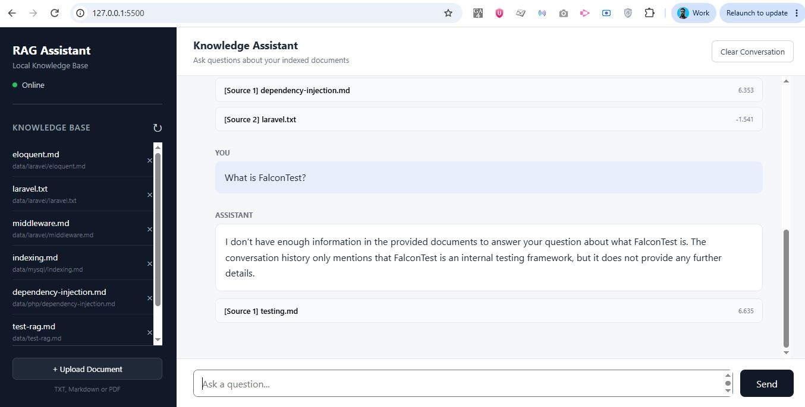

# Local Corrective RAG Assistant

A full-stack Retrieval-Augmented Generation (RAG) application for
question answering over a local document knowledge base.

The system combines **semantic vector search and BM25 keyword retrieval**,
uses **Reciprocal Rank Fusion and cross-encoder reranking**, and implements
a **corrective RAG workflow with LangGraph** to grade retrieved documents
and retry retrieval when necessary.

Generation runs locally using **Ollama**, while **FastAPI** exposes the
backend to a lightweight web interface.



## Highlights

- Hybrid Chroma + BM25 retrieval
- Reciprocal Rank Fusion (RRF)
- Cross-encoder reranking
- Corrective retrieval with LangGraph
- LLM-based document relevance grading
- Conversational query rewriting
- Structured citations with source excerpts
- Dynamic TXT, Markdown and PDF ingestion
- Local generation with Ollama
- FastAPI REST API
- Web-based chat and document management
- Retrieval evaluation using Hit@K, MRR and rejection accuracy

## Features

- Local RAG pipeline
- Conversational question answering
- Query rewriting for follow-up questions
- Semantic retrieval with Chroma
- Keyword retrieval with BM25
- Reciprocal Rank Fusion (RRF)
- Cross-encoder reranking
- LLM-based document relevance grading
- Corrective query rewriting and retrieval retry
- Structured source citations
- TXT, Markdown, and PDF ingestion
- Dynamic document upload and deletion
- FastAPI REST API
- LangGraph workflow orchestration
- Local LLM inference with Ollama
- Web-based chat interface
- Retrieval evaluation with Hit@K, MRR, and rejection accuracy

## Architecture

```text
                          User
                            │
                            ▼
                      Web Frontend
                            │
                            ▼
                         FastAPI
                            │
                            ▼
                       LangGraph
                            │
                    Query Rewriting
                            │
                            ▼
                 ┌─────────────────────┐
                 │  Hybrid Retrieval   │
                 │                     │
                 │ Chroma       BM25   │
                 └──────┬───────┬──────┘
                        │       │
                        └───┬───┘
                            ▼
                  Reciprocal Rank Fusion
                            │
                            ▼
                    Cross-Encoder Reranker
                            │
                            ▼
                     Document Grader
                            │
                   ┌────────┴────────┐
                   │                 │
               Relevant        Not Relevant
                   │                 │
                   │          Corrective Rewrite
                   │                 │
                   │          Retrieval Retry
                   │                 │
                   │          Still irrelevant?
                   │                 │
                   │              Fallback
                   ▼
                     Ollama LLM
                         │
                         ▼
               Answer + Citations
```

## RAG Pipeline

### 1. Document ingestion

TXT, Markdown, and PDF documents are loaded and split into overlapping chunks.

Each chunk receives metadata including:

- source
- filename
- file type
- page number where available
- stable chunk ID

### 2. Embeddings

Chunks are embedded using:

`sentence-transformers/all-MiniLM-L6-v2`

Embeddings are stored locally in Chroma.

### 3. Hybrid retrieval

Two retrieval strategies are combined:

**Semantic retrieval**

Chroma performs vector similarity search.

**Keyword retrieval**

BM25 provides lexical matching for exact terms and technical keywords.

### 4. Reciprocal Rank Fusion

Results from vector search and BM25 are combined using Reciprocal Rank Fusion (RRF).

This avoids directly combining incompatible vector-distance and BM25 score scales.

### 5. Cross-encoder reranking

The retrieved candidates are reranked using:

`cross-encoder/ms-marco-MiniLM-L-6-v2`

The cross-encoder jointly evaluates the query and candidate chunk to improve final ranking quality.

### 6. Document grading

An LLM relevance grader checks whether the final retrieved chunks contain information useful for answering the question.

If no relevant documents remain, the LangGraph workflow can perform a corrective query rewrite and retry retrieval.

### 7. Grounded generation

The final relevant context is passed to a local Ollama model.

The model is instructed to answer only from retrieved context and reference supporting chunks using source identifiers such as:

`[Source 1]`

### 8. Structured citations

The API returns citation metadata including:

- source
- filename
- file type
- page
- chunk ID
- reranker relevance score
- excerpt

## Tech Stack

### AI / RAG

- Python
- LangChain
- LangGraph
- SentenceTransformers
- Chroma
- BM25
- CrossEncoder
- Ollama

### Backend

- FastAPI
- Pydantic
- Uvicorn

### Frontend

- HTML
- CSS
- JavaScript

## Project Structure

```text
rag-learning/
├── frontend/
├── src/
├── data/
├── eval/
├── screenshots/
├── .env.example
├── .gitignore
├── README.md
└── requirements.txt
```

## Prerequisites

Install:

- Python 3.10+
- Ollama
- Git

Pull the local model:

```bash
ollama pull llama3.2
```

## Installation

Clone the repository:

```bash
git clone YOUR_REPOSITORY_URL
cd rag-learning
```

Create a virtual environment:

### Windows

```powershell
python -m venv .venv
.venv\Scripts\Activate.ps1
```

### macOS / Linux

```bash
python3 -m venv .venv
source .venv/bin/activate
```

Install dependencies:

```bash
python -m pip install -r requirements.txt
```

## Run the Backend

Make sure Ollama is available, then run:

```bash
python -m uvicorn api:app --app-dir src --reload
```

FastAPI:

```text
http://127.0.0.1:8000
```

Swagger documentation:

```text
http://127.0.0.1:8000/docs
```

## Run the Frontend

Open another terminal:

```bash
cd frontend
python -m http.server 5500
```

Open:

```text
http://127.0.0.1:5500
```

## API Endpoints

| Method | Endpoint | Purpose |
|---|---|---|
| GET | `/health` | Backend health check |
| POST | `/chat` | Ask the RAG assistant |
| GET | `/documents` | List knowledge-base documents |
| POST | `/documents` | Upload and index a document |
| DELETE | `/documents` | Delete a document and its indexed chunks |
| DELETE | `/sessions/{session_id}` | Clear conversation history |

## Retrieval Evaluation

The project includes retrieval evaluation covering:

- Hit@K
- Mean Reciprocal Rank (MRR)
- rejection accuracy

The evaluation compares:

1. Vector retrieval
2. Hybrid retrieval
3. Hybrid retrieval + cross-encoder reranking

Evaluation results depend on the active test corpus and should be interpreted together with the size and difficulty of the evaluation set.

## Design Decisions

### Why hybrid retrieval?

Vector search works well for semantic similarity, while BM25 performs well for exact terminology and technical keywords.

Combining both improves retrieval coverage.

### Why RRF?

Vector distance and BM25 scores are not directly comparable.

RRF combines ranked results instead of adding incompatible raw scores.

### Why a cross-encoder?

Bi-encoder embeddings make large-scale retrieval efficient.

A cross-encoder is slower but can more accurately evaluate query-document relevance, so it is applied only to a small candidate set.

### Why LangGraph?

The initial RAG pipeline can be implemented with ordinary Python.

LangGraph becomes useful when the workflow introduces conditional routing and retry behavior:

```text
retrieve
   ↓
grade
   ├── relevant → generate
   └── irrelevant → rewrite → retrieve again
```

### Why Ollama?

Ollama allows the application to run the generation model locally without requiring a hosted LLM API.

## Current Limitations

- Conversation sessions are stored in memory and are lost when the backend restarts.
- Session state is not designed for multiple backend workers.
- BM25 is currently rebuilt from filesystem documents during search.
- Local LLM grading increases response latency.
- Reranker scores are ranking signals, not calibrated confidence probabilities.
- Uploaded document/index updates are not fully transactional.
- The current evaluation corpus is intentionally small and should be expanded for stronger benchmarking.

## Future Improvements

- Persistent conversation storage
- Streaming responses
- Structured-output relevance grading
- BM25 index caching and refresh
- Larger retrieval evaluation dataset
- Docker support
- Authentication and document ownership
- Production deployment

## Security Notes

Uploaded document content and generated LLM output should be treated as untrusted input.

The frontend renders generated text using safe text operations rather than injecting raw HTML.

Environment files, local vector databases, virtual environments, and runtime-uploaded documents are excluded from version control.

## License

This project is intended for learning and portfolio demonstration.